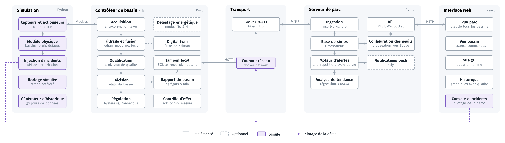

# ORCA : POC

Projet de SI5 Polytech Nice Sophia, spécialité IoT & CPS.
Lorenzo Baladier, Marius Barbaud.

ORCA surveille et régule les bassins d'un aquarium public. Ce dépôt contient le POC : les bassins,
capteurs et actionneurs sont simulés, le contrôleur de bassin, le serveur de parc et l'interface
web sont développés.

## Composants

| Dossier | Rôle | Technologies |
|---|---|---|
| [`simulator/`](simulator/) | Bassins simulés, capteurs et actionneurs en Modbus TCP, injection d'incidents | Python, pymodbus, FastAPI |
| [`edge/`](edge/) | Contrôleur de bassin (un conteneur par bassin) | Rust, tokio, tokio-modbus, rumqttc, SQLite |
| [`fog/`](fog/) | Serveur de parc : ingestion, alertes, analyse, API | Python, FastAPI, TimescaleDB |
| [`web/`](web/) | Interface de supervision et console d'incidents | TypeScript, React, Vite |
| [`docs/`](docs/) | Rapports de conception, schéma d'architecture | LaTeX |

Les composants communiquent par MQTT (broker Mosquitto).

## Documentation

- [Périmètre du POC](docs/PERIMETRE-POC.md) : capteurs, fonctions par composant, incidents, démo
- [Rapport d'architecture](docs/ORCA-rapport-archi-BALADIER-BARBAUD.pdf)
- [Rapport Data Ingestion Pipeline](docs/ORCA-rapport-data-BALADIER-BARBAUD.pdf)

## Planning

Six séances de 4 h. Chaque séance correspond à un milestone GitHub. Les issues sont réparties sur
deux pistes :

- `terrain` : simulateur et contrôleur de bassin
- `supervision` : serveur de parc et interface web

| Séance | Contenu | Livrable | Issues |
|---|---|---|---|
| S1 | Contrats d'interface, simulateur v0, edge v0, infrastructure, fog et interface v0 | Une température simulée affichée dans l'interface | #1 à #5 |
| S2 | Toutes les grandeurs, prétraitement et qualification, Rapport de bassin, ingestion, vues temps réel, CI | Les 6 bassins en direct, chaque mesure avec sa qualité | #6 à #11 |
| S3 | Machine d'états, régulation, tampon local, alertes, API d'incidents, console d'incidents | INC-03 à 07, 09 et 10 jouables | #12 à #17 |
| S4 | Digital twin, vérification des commandes, historique 30 jours, analyse de tendance | INC-01, 02 et 08 jouables, historique consultable | #18 à #22 |
| S5 | Vue 3D, configuration des seuils, scénarios de démo, rôles ; notifications et délestage en optionnel | Démo complète | #23 à #28 |
| S6 | Tests de bout en bout, documentation, répétition de la démo | Dépôt finalisé, vidéo de secours | #29 à #31 |

## Conventions

Messages de commit au format [Conventional Commits](https://www.conventionalcommits.org/fr/),
avec le numéro de l'issue. Exemple : `feat(edge): filtre médian (#7)`.
